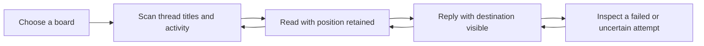

# Forum IM: CPO assessment of the current experience

Date: 2026-11-17, Asia/Hong_Kong. Research branch:
`research/improve-ui-ux-2026-11-17`, based on `feat/improve-ui-ux` at `8b04f4a`.
This is a product assessment and experiment plan, not an implementation approval,
release qualification, or a replacement for the accepted requirements.

## Product judgment

**Make it easy to find a discussion, understand what changed, contribute, and
return without losing context.** That is the useful combination of a forum and
IM. Discord contributes immediacy and continuity; Reddit contributes durable,
discoverable discussions. Neither requires TSDM to become a single chat stream,
invent nested replies, or change its Board → Thread → Post model.

The current foundation is strong: stable list/reader regions, explicit latest-post
destinations, retained writing, a compact composer, and deliberate handling of
uncertain publication already exist. The next improvement should be **information
hierarchy and visible context**, rather than another feature layer or a new visual
theme. In the observed build, the list reveals too few choices, while expanding
writing removes the visible identity of the thread being answered.

The first implementation candidate should combine two small, reviewable changes:
keep a human-readable destination visible during expanded writing, and make the
existing 300px thread column a more useful index. Test those independently before
changing global navigation.

## Baseline, authority and method

The supplied `ui-ux-112/tsdm-ui/dist/tsdm-ui.user.js` worktree path no longer exists.
The surviving `feat/ui-ux-112` ref and `feat/improve-ui-ux` both point to `8b04f4a`.
The current checkout's `dist/tsdm-ui.user.js` has SHA-256:

```text
8db22dbd2a00a7d6ecbd237047a466e2bb6478e43f4d9aa35da603010f5f20f6
```

The existing in-app browser and a fresh audit tab both executed that exact source:
read the loaded Tampermonkey script through CDP, remove only its manager wrapper,
and hash the remaining userscript. Its 2,454,676 JavaScript characters hash to the
same value as the local UTF-8 file. No installation or production code was changed.

Evidence has four separate authorities:

1. **Current browser observation:** real board → thread → empty compact reply →
   expanded reply → list return at 1440×900, 390×844 and 320×740. No text was entered
   and no reply, rating, report, upload or subscription was submitted. Temporary
   viewport overrides and the audit tab were removed; the original tab was retained.
2. **Current deterministic replay:** six existing complete-app Edge cases, with
   only external forum responses substituted; five passed and one failed on a
   superseded no-shadow expectation. See the evidence section below.
3. **Repository evidence:** source, glossary, ADRs, #95, #112 and the later row-shadow
   correction. Historical ledgers remain evidence for their own candidates.
4. **Primary-source research:** Android, Discord, Reddit and W3C; facts, product
   inferences and research-method trade-offs are in the
   [supporting source study](forum-im-primary-sources-2026-11-17.md).

This is expert inspection, not a study of TSDM members. No task-time baseline,
participant preference, conversion uplift, physical mobile behavior or full WCAG
conformance is established.

### Precedence matters

[Issue #95](https://github.com/Benson-mk/tsdm-ui/issues/95) and the
[November 13 specification](../implementation/forum-im-ux-spec-2026-11-13.md)
provide the original intent. Their visual Enter-to-send and reading-visible-while-
expanded wording is superseded by the [#112 ledger](../implementation/ui-ux-112.md)
and [ADR0001](../adr/0001-share-forum-workflows-across-layouts-and-hosts.md):
Ctrl/Cmd+Enter sends in both modes; expanded writing temporarily owns the thread
column. The [subsequent owner correction](../implementation/thread-pane-soft-controls.md)
requires the documented shadow on individual thread rows. Preserve all three.

The legacy experiment `DESIGN.md` supplies the requested color scheme. Its older
flat-row and decorative-card-border recipes do not override those instructions.
No ADR amendment or costly-to-reverse technical choice is proposed here.

## First principles and intended experience

The member's recurring questions are: **Where am I? What deserves my attention?
What am I answering? Did my contribution arrive? Can I continue where I stopped?**
Every prominent element should help answer one of them.

| User job                | Primary information/action                                      | Supporting information                                  |
| ----------------------- | --------------------------------------------------------------- | ------------------------------------------------------- |
| Return to a known board | Recognizable board and retained list position                   | Directory, search, saved destinations                   |
| Choose a thread         | Title, meaningful latest activity, local writing indicator      | Original author/date, views, board statistics           |
| Read a thread           | Content, author, source-backed position, explicit new arrivals  | Page picker, refresh policy, less frequent post actions |
| Reply                   | Visible destination, writing field, explicit Send               | Formatting, attachments, source mode, optional Preview  |
| Recover                 | Exact affected writing or attempt and one appropriate next step | Inspectable details; uncertainty remains explicit       |



This is a task loop, not a proposal to replace the architecture. Existing
navigation, local reply drafts, conflict handling and immutable outgoing replies
already support it. Do not add speculative unread counts, presence, realtime
delivery, ranking, cloud drafts or automatic retries to make it look more like IM.

## Findings and prioritized experiments

Priority is a product judgment based on the observed interruption, not a measured
frequency or an assertion that all users encounter it.

| ID / priority                         | Observed evidence                                                                                                                                                                                                                                                                          | Interpretation and proposed experiment                                                                                                                                                                                                                               | Acceptance for a future implementation                                                                                                                                                                                                                                                                                                  |
| ------------------------------------- | ------------------------------------------------------------------------------------------------------------------------------------------------------------------------------------------------------------------------------------------------------------------------------------------ | -------------------------------------------------------------------------------------------------------------------------------------------------------------------------------------------------------------------------------------------------------------------- | --------------------------------------------------------------------------------------------------------------------------------------------------------------------------------------------------------------------------------------------------------------------------------------------------------------------------------------- |
| F1 / P1                               | At 390px, expanded general-reply writing shows global brand/navigation, toolbar, editor and Send. The thread title and board are absent visually. The accessible tree retains a writing-destination region, but it contains board/thread IDs rather than a visible thread title.           | Give expanded writing a slim context line such as “Reply · [thread title]”, with a clear Compact action. Preserve full-column editing and the existing no-sender-label direction. General replies need context too, not only addressed replies.                      | At 320px, enlarged text and short height, a member can identify the destination without collapsing writing. Long CJK titles remain available. Expansion/compaction preserves editor instance, source, selection, undo, attachments and target. No extra publication confirmation.                                                       |
| F2 / P1                               | At 1440×900, the list stays 300px wide; its first three ordinary rows are approximately 213px high and 252px wide. The first starts at y=381. Only two rows are fully visible before scrolling. Each presents category, title, original author/date, replies/views and latest author/time. | Preserve the fixed column and row shadows. Trial a stronger title + latest-activity hierarchy, with secondary historical metadata available on deliberate reveal. Use whitespace between meaningful groups rather than giving every metadata field equal separation. | With one- or two-line fixture titles at default text size, trial at least four complete ordinary choices in a 900px-high view. This is an experiment target, not a fixed row height or a requirement at enlarged text. Preserve complete title access, exact latest-post destination, 44px primary targets, selection and list anchors. |
| F3 / P1, paired with F2               | The observed board's heading, statistics, subordinate-board heading/card and control strip consume about 320px below the 60px global bar before the first ordinary thread. Pins and filters are already collapsed.                                                                         | Keep board identity visible; trial a compact “About / sub-boards” disclosure for longer board context. Preserve genuine restrictions and urgent notices in context. This is not another request to collapse pins or filters.                                         | The first ordinary choice is reachable sooner with the same sample. Subordinate boards and their posting restrictions remain discoverable by keyboard/touch. Toggling context does not move the selected reader, rewrite filters or lose writing.                                                                                       |
| F4 / P2, validate with members        | At narrow widths, global navigation is a grid icon, list icon and external-link icon. Accessible names are accurate but sighted users see no board/thread destination labels. “Threads pane” describes layout machinery.                                                                   | Trial task-oriented visible wording or a compact board/back context in the existing header. Keep the current progressive pane model; do not add a bottom navigation system before testing comprehension.                                                             | Without coaching, a participant can return to the list and change boards, then recover the same reader/writing. Keyboard names and visible wording agree; native-forum escape stays available.                                                                                                                                          |
| F5 / P2                               | A narrow post header shows author, a multi-line timestamp, “Floor 1#”, a separate “Post [database ID]” permalink button and ⋯ before the body.                                                                                                                                             | Use the source-backed ordinal as the normal permalink label where available; keep exact identity in the URL/accessibility/details as needed. Tighten identity/time hierarchy while retaining the menu. Do not alter user-authored rules, tables or formatting.       | Correct permalink and truthful copy feedback are unchanged; unknown ordinals have an honest fallback. Authors, timestamps and actions remain readable at 320px. Post menus retain all qualified actions.                                                                                                                                |
| F6 / maintenance before UI acceptance | The current B1 desktop E2E fails because it still expects `box-shadow: none`. The four newer pane cases require and pass the owner-approved 6% shadow.                                                                                                                                     | Reconcile this obsolete expectation in the next implementation task, retaining the width/position assertions and the historical failed receipt. Do not remove the shadow to make the old assertion pass.                                                             | The amended complete-app case passes on the same intended design; the diff changes the obsolete oracle only, not the user outcome or safety checks.                                                                                                                                                                                     |

F1 and F2/F3 are independently reviewable. F4 requires usability evidence before a
navigation redesign. F5 is a presentation refinement; exact post identity remains
the forum client's responsibility. F6 is a verified specification/test mismatch,
not evidence that the approved row shadow is a product regression.

### What already works in the inspected path

The compact composer leaves reading visible and keeps its input and actions in one
row. At 320px, the measured expanded toolbar, Compact and Send buttons retain 44px
targets and fit horizontally. The narrow return path reveals the list; the existing
E2E separately passes anchor restoration after enlarged-text reflow. Row shadows,
zero decorative row borders, selection and keyboard boundaries pass the four
focused desktop/narrow/Dark/forced-color cases.

These positives constrain the redesign. Do not sacrifice them to make an isolated
screenshot cleaner. The 320px inspection did not exercise the complete keyboard,
overlay, failure or recovery matrix.

## Visual direction: document the reasons for depth and space

Use the existing color roles, not a new Discord-purple or Reddit-orange accent.
The exact approved palette and paired foregrounds are recorded in the legacy
design and [#91](../implementation/91-palette.md); current mappings are in
[styles.css](../../src/styles.css).

| Role                               | Retained colors / treatment                                                                              |
| ---------------------------------- | -------------------------------------------------------------------------------------------------------- |
| Light canvas, body, quiet metadata | `#ffffff`, `#000000`, `#666666`; soft surface `#eeeeee`                                                  |
| Board/category identity            | Pale green `#ebf5e8`, lavender `#a29bba`, dusty rose `#dda49f`, blue `#a6c6e1`; inverse purple `#6d5175` |
| Existing warm/mint extensions      | `#c88f8c`, `#ceddc8`; reserve colors require an explicit semantic use and contrast check                 |
| Alias palette                      | `#a6c6e1`, `#616379`, `#f5e9d1`, `#c2b8da`, `#ebf5e8`                                                    |
| Mono / Dark                        | Preserve the existing role mappings and neutral palette; do not invert or recolor member media           |
| Thread rows and floating menus     | `0 4px 16px rgb(0 0 0 / 6%)`; thread-row shadow remains intentional                                      |
| Dialogs / scrim                    | `0 16px 48px rgb(0 0 0 / 24%)` / existing 60% black scrim                                                |
| Reading flow                       | Flat post bodies; typography and spacing establish grouping                                              |

“Documented shadows and whitespace” should express hierarchy, not replace every
border with another shadow. Functional input, quote/table, selected-state and
focus boundaries remain. Dark and forced colors need their existing explicit
boundaries where shadows cannot communicate structure. These are usability cues,
not decorative separators. Scope any future token edits to the affected surface;
do not globally change shared shadows to solve one crowded list.

**Edge-to-edge means continuous surfaces with protected content.** Extend canvas,
header, reader and composer surfaces to the browser's available edges. Apply
insets to exposed controls and content, retain reading gutters, and avoid adding
safe-area padding twice where panes meet. A generous canvas does not require
edge-touching text or an unlimited reading line.

This follows the supplied [Android guidance](https://developer.android.com/design/ui/mobile/guides/layout-and-content/edge-to-edge)
at the level of design intent. The existing [#92 browser implementation](../implementation/92-browser-edges.md)
already handles safe areas and viewport adaptation. This research neither
reimplements those features nor claims control over native system bars or proof
of physical keyboard/cutout behavior.

## Validation plan before production edits

Record the failure inventory first. Reuse the complete-application HTTP-boundary
E2E seam described in #95 and [ADR0002](../adr/0002-qualify-installed-releases-with-bounded-evidence.md).
No unit tests or production code were added in this research.

1. **Destination:** expand a general and an addressed reply; use a long CJK title;
   switch threads, return, compact and expand. Fail on wrong/absent destination,
   source/selection/undo loss or changed submission meaning.
2. **Scanning:** use reproducible long/short titles, absent/latest metadata, pins,
   subordinate boards and a selected row. Fail on clipped unique title information,
   indistinguishable latest destinations, inaccessible details or wrong navigation.
3. **Continuity:** retain the visible row through open/back, context disclosure,
   asynchronous status and enlarged-text reflow. Fail on an unexpected jump or
   hidden current selection. Preserve writing across filter and board transitions.
4. **Access and edges:** 1440/905/390/320 CSS-pixel widths, enlarged text, short
   viewport, all themes, forced colors and keyboard traversal. Fail on stranded
   Send/Compact, obscured focus, page overflow or duplicated safe-area reserves.
5. **Recovery:** replay failed/unknown sends, conflicting drafts and unavailable
   attachments after presentation changes. Fail if quieter presentation hides an
   actionable failure or implies saved/sent status without acknowledgement.

Retain candidate/source hashes, screenshots, focus/geometry observations and request
ledgers for every E2E run. Use installed Edge/Chrome checks for the affected host
behavior; a resized in-app view is not mobile-device or release qualification.

Then run a small formative study with returning forum members and keyboard/touch
users. Ask them to find an active discussion, explain its latest activity, reply to
a specific post, expand, switch and resume, then interpret a failed versus unknown
attempt. Record success, wrong destinations, assistance, lost context and completion
time. Establish the baseline before selecting improvement thresholds. Small samples
can expose problems; they do not establish population-wide preference or uplift.

## Repeatable evidence and current limitation

Current run: `evidence/runs/2026-11-17T03-48-35.604Z/`.
It retains the reporter's receipt, source manifest, screenshots, request ledgers,
scenario sources and hashed file manifest. The compact public result is
[forum-im-audit-evidence-2026-11-17.json](forum-im-audit-evidence-2026-11-17.json).

```sh
npm run test:e2e -- tests/e2e/compact-board-controls.spec.ts \
  tests/e2e/stable-board-browsing.spec.ts \
  --grep 'Pane.icons|B1.desktop:|B1.narrow-Threads'
```

Observed runtime: macOS arm64, Edge `157.0.4341.60`, Playwright `1.64.1`,
Node `26.0.0`, npm `11.12.1`. The repository pins Node `24.22.0` and npm `11.21.1`;
this diagnostic replay used the available runtime and the existing exact bundle,
without rebuilding. It is not pinned-toolchain build qualification.

**Result: five passes, one failure; the run remains failed.**
`stable-board-browsing.spec.ts:90` expects `none`, while the rendered row uses the
documented 6% shadow. The preceding width/position assertions completed, and the
receipt retains their geometry. This research does not edit the test or claim the
full suite is green. A future implementation should reconcile F6 before acceptance.

Live screenshots and the observation summary stay private under
`evidence/runs/research-ui-ux-2026-11-17-private/`; only aggregate measurements and
synthetic test outcomes enter this document. To repeat the live inspection, open
a board with sub-boards and active threads, verify the installed script hash,
use the three recorded viewports, open an ordinary thread, enter an empty reply,
expand/compact, and return to its list. Live ordering and content will change;
use authored fixtures for stable density comparisons.

## Trade-off ledger

Each distinct choice is recorded once here or in the supporting study's three
research-method entries. Proposed product changes remain hypotheses, with their
costs explicit; none has been silently implemented.

| ID  | Choice                                                                         | Benefit                                                              | Cost / limit                                                                                |
| --- | ------------------------------------------------------------------------------ | -------------------------------------------------------------------- | ------------------------------------------------------------------------------------------- |
| T1  | Use the surviving current bundle/ref and verify loaded bytes                   | Grounds the audit in the latest available build                      | Cannot attest to files from the removed worktree independently                              |
| T2  | Inspect live reading and empty composition without consequential writes        | Tests the real visual flow without creating forum activity           | Live send outcomes, uploads, conflict and recovery behavior are not newly qualified         |
| T3  | Replay existing E2Es against the exact bundle on the available runtime         | Adds repeatable current evidence without changing the candidate      | Toolchain differs from the pinned release environment; result is diagnostic                 |
| T4  | Keep live captures private; commit authored findings and synthetic summary     | Preserves audit provenance without publishing authenticated captures | Other readers need their own account/live session to reproduce those observations           |
| T5  | Keep this branch limited to research, including the discovered obsolete oracle | Makes recommendations and the baseline independently reviewable      | The known test/spec mismatch remains for the next implementation task                       |
| T6  | Add a visible destination during full-column expanded editing (F1)             | Preserves orientation when posts are hidden                          | Uses some editor height and needs a long-title disclosure strategy                          |
| T7  | Prioritize title/latest activity; reveal secondary metadata (F2)               | More useful choices fit in the fixed list                            | Original dates/views take another action to inspect; full information must remain available |
| T8  | Collapse longer board context separately from thread controls (F3)             | Threads appear earlier                                               | Sub-board discovery takes another action; important posting restrictions cannot disappear   |
| T9  | Trial visible task-oriented navigation cues (F4)                               | Reduces dependence on icon recognition                               | Consumes scarce header width and needs careful short labels                                 |
| T10 | Prefer the post ordinal over its database ID in routine reading (F5)           | Reduces technical clutter without changing the permalink             | Raw identity moves to details; absent ordinals need an honest fallback                      |

The supporting study additionally records: attributable official documentation
instead of a competitor usability survey; transferring principles while retaining
forum semantics; and a bounded accessibility investigation instead of full
conformance assessment. These are the complete additional method trade-offs.

## Research acceptance

- [x] Identify the actual current candidate and verify the observed loaded source.
- [x] Inspect the existing product and reconcile later owner decisions with #95.
- [x] Ground the recommendation in primary sources and reuse the supplied colors.
- [x] Distinguish observed problems, hypotheses, existing capabilities and limits.
- [x] Provide prioritized experiments, failure-first E2E expectations and a trade-off ledger.
- [x] Preserve repeatable evidence and report the failed baseline check truthfully.

All research criteria above are verified. Product implementation, participant
validation and release acceptance remain future work, not completed criteria.
